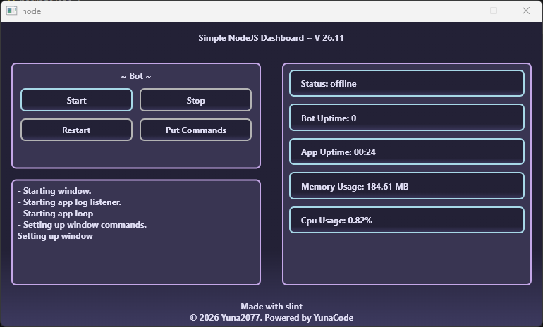

Simple NodeJS discord bot interface
---
This dashboard was made from the [slint-nodejs-template](https://github.com/slint-ui/slint-nodejs-template)

## Software this bot uses
Slint, discord.js, discord-api-types

# Setup
Rename the template.env.js under ./src to env.js

Fill in the blank values in the env.js such as BOT_TOKEN and BOT_CLIENT_ID

Then install the modules via npm install

After that you can start the app using `npm start`